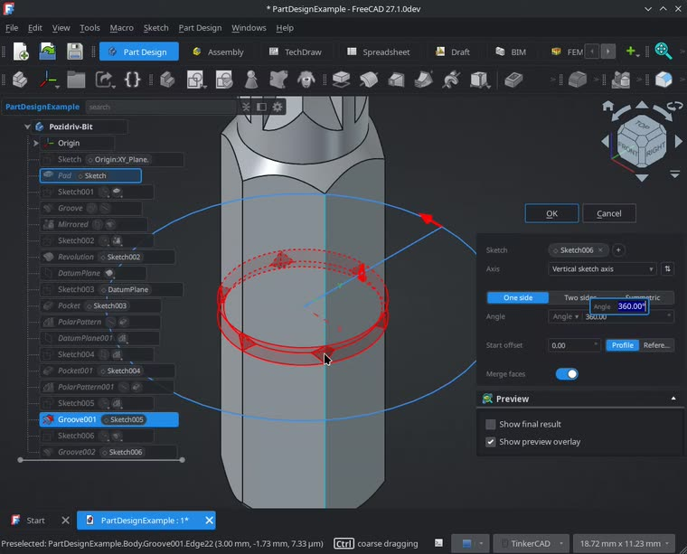
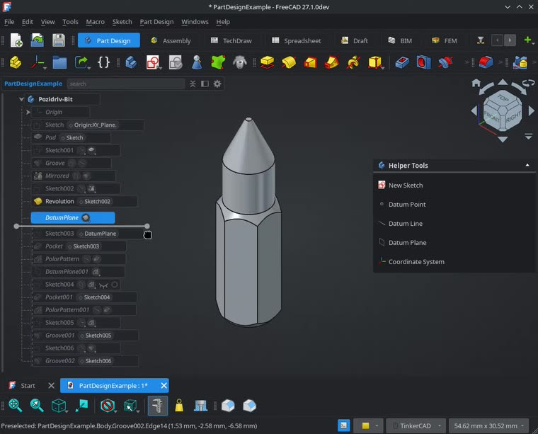
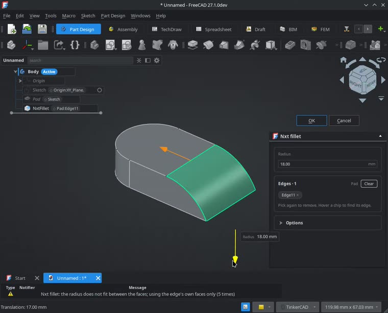
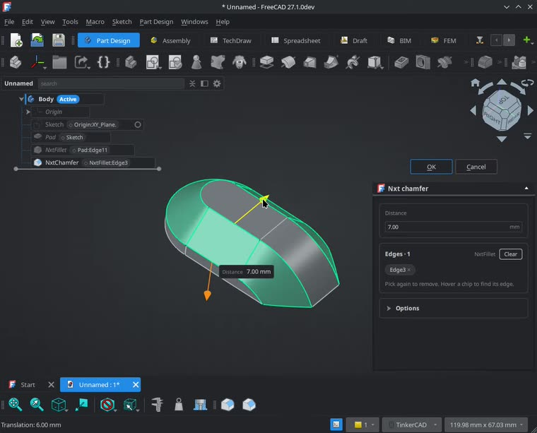
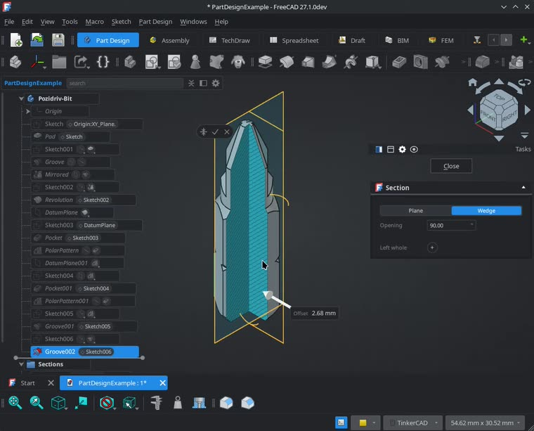
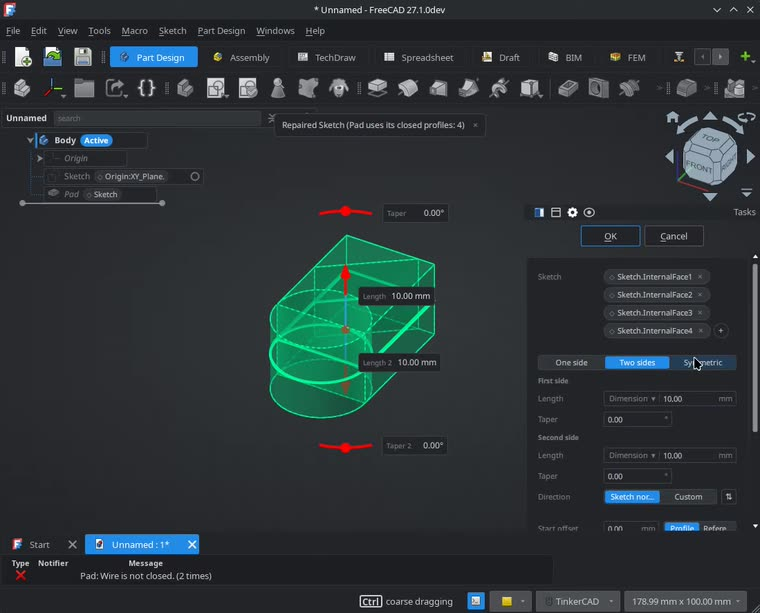
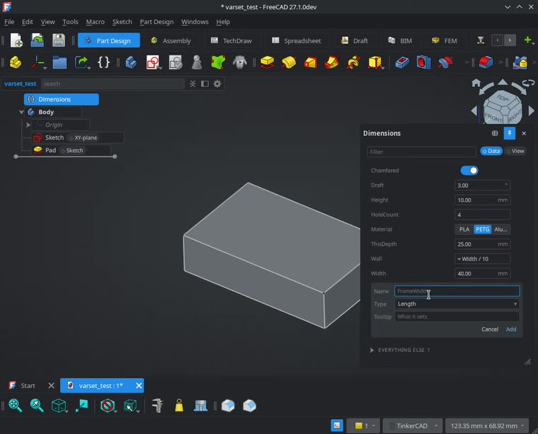

# Nxt

**A modern, fluid interface for FreeCAD, built on Qt Quick.**

[](https://github.com/obelisk79/FreeCAD-Nxt/actions/workflows/checks.yml)
[](https://ko-fi.com/K4H827QS0N)

> [!WARNING]
> **Experimental: Nxt is under heavy development.** Expect bugs, rough
> edges, and features that change or disappear between updates without
> notice. Report problems on the
> [issue tracker](https://github.com/obelisk79/FreeCAD-Nxt/issues).

Nxt is an addon that gives FreeCAD a cleaner, faster way to work: a model
tree you can read at a glance, edits made right on the model, and tools
that fix common problems before they stop you. Your files stay ordinary
FreeCAD files, and FreeCAD's full parametric power is still underneath.

---

## Highlights

* **A model tree that reads like a story**: features in the order they
  were made, with what each one uses shown beside it
* **Edit on the model**: double-click a face to edit the feature that
  made it, with values and drag handles right in the 3D view
* **Rollback anywhere**: drag the history bar to see the model as it was
  at any step
* **Robust fillets and chamfers**: Nxt's own engine, with smooth corners,
  fades and the same result whatever order you pick edges in
* **Section views**: up to three cutting planes, or a wedge, with hatched
  caps that update as you drag
* **Problems fixed before they fail**: "Wire not closed" sketches are
  caught and repaired as you create a feature
* **Clearer task panels and Property Inspector**: grouped cards, quick
  edits with the mouse wheel, and plain warnings when something goes
  wrong
* **Variables you can manage**: add, rename and edit VarSet variables in
  place
* **Quick Mass, Isolate and more**: see a selection's mass, focus on one
  part, and toggle visibility with Space
* **Undo-friendly**: one-click Undo on Nxt's automatic fixes, and clean
  removal of every setting if you uninstall

---

## See it in action

*Click a picture to play its video.*

### Double-click to edit

Double-click any face to edit the feature that made it, with its value
and handles right on the model.

[](docs/media/double-click-to-edit.mp4)

### Rollback history

Drag the bar in the tree to step back through the model's history, and
forward again.

[](docs/media/rollback-history.mp4)

### Robust fillets

Corners blend into one smooth patch, and a fillet fades out where it
runs into another, instead of leaving a step.

[](docs/media/robust-fillet.mp4)

### Robust chamfers

The same engine bevels edges cleanly, with a choice of corner styles.

[](docs/media/robust-chamfer.mp4)

### Section views

Slice through the model with up to three planes, or cut a wedge out of
it. The cut faces are capped and hatched, and you can leave chosen parts
whole.

[](docs/media/section-view.mp4)

### No more "Wire not closed"

Pad a sketch with a gap or stray lines, and Nxt repairs it so the
feature builds, with Undo one click away.

[](docs/media/avoid-wire-not-closed.mp4)

### Edit variables in place

Add, rename and change VarSet variables right in the Property Inspector.

[](docs/media/edit-varset.mp4)

---

## More features

### Model tree
* Features in creation order, grouped clearly, with the geometry each one
  uses shown as chips beside it
* Error chips you can click to jump straight to a fix
* Overlay mode that floats the tree over the 3D view
* Rename in place, drag to reorder, and search that takes you to a match
* Right-click menus built around what you're most likely to do next

### Editing
* Property Inspector with grouped cards for the selection, and task panels
  for Pad, Pocket, Revolution and Groove in the same layout
* Number fields that step with the mouse wheel, fine or coarse, like the
  3D drag handles
* Double-click a sketch's chip to edit that sketch
* Picking a face shows the feature that actually made it, even after
  later cuts

### Tools
* Nxt Fillet and Nxt Chamfer, which also work with Mirror and the
  patterns
* Section views that stay with the document, aligned to an axis, the view,
  a face, a datum plane or three points
* Quick Mass, showing a selection's mass in the material you choose
* Isolate, to show just what you're working on and restore everything
  after
* A notice at startup when addons have updates

---

## Getting Started

### Installation

#### Option 1: FreeCAD Addon Manager

1. Open **FreeCAD**.
2. Go to **Tools** ➔ **Addon Manager**.
3. Search for **FreeCAD-Nxt** and click **Install**.
4. Restart FreeCAD.

#### Option 2: Manual installation

Clone or copy the repository into your FreeCAD `Mod` folder:

* **Linux**: `~/.local/share/FreeCAD/Mod/FreeCAD-Nxt`
* **macOS**: `~/Library/Application Support/FreeCAD/Mod/FreeCAD-Nxt`
* **Windows**: `%APPDATA%\FreeCAD\Mod\FreeCAD-Nxt`

```bash
git clone https://github.com/obelisk79/FreeCAD-Nxt.git <PATH TO YOUR OS Mod DIRECTORY>
```
